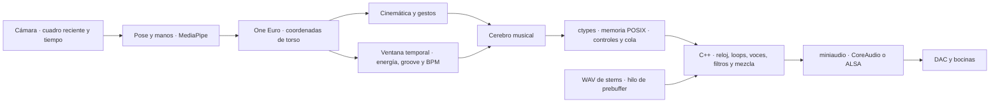

# Cómo funciona el código del CV-DAW

## Ruta de cámara a bocinas



En modo offline el mismo DSP escribe opcionalmente un WAV y no abre un dispositivo de audio. En modo mock se generan muñecas y tobillos sinusoidales sin manos, con tiempo sintético a 60 Hz. El modo vídeo usa el índice del cuadro dividido por los FPS del archivo, con 30 FPS de respaldo. El modo cámara usa el reloj monotónico de captura. El hilo de contexto admite un solo trabajo pendiente y reutiliza el último resultado disponible. La ruta rápida no espera su inferencia. [Bucle principal](../composer/performance.py#L42)

## Archivos y responsabilidades

| Archivo o grupo | Responsabilidad |
| --- | --- |
| [composer/performance.py](../composer/performance.py#L42) | Punto de entrada integrado, simulación, arranque, actualización, ventana y reporte |
| [composer/app.py](../composer/app.py#L20), [composer/cameras.py](../composer/cameras.py) | Arranque y supervisión del proceso, captura de último cuadro y selección de cámara. `app.py` también ejecuta el compositor anterior |
| [perception_layer.py](../perception_layer.py#L135), [perception/run.py](../perception/run.py#L30) | Módulo 1. Adaptadores de cámara/inferencia, filtros, normalización y visualización. `run.py` proporciona el adaptador MediaPipe compartido y una entrada Linux anterior |
| [feature_extractors.py](../feature_extractors.py#L81) | Módulo 2. Gestos, cinemática por extremidad, ventana de contexto y estimador de rebote |
| [tflite_model.py](../tflite_model.py#L5) | Intérprete TFLite opcional, delegado y conversión por tensor entre flotantes y enteros cuantizados |
| [musical_brain.py](../musical_brain.py#L52) | Módulo 3. Estado, selección de notas, cuantización y controles musicales |
| [composer/ipc.py](../composer/ipc.py#L10), [realtime/vision_mock_sender.py](../realtime/vision_mock_sender.py), [realtime/ipc_bridge_c.cpp](../realtime/ipc_bridge_c.cpp#L5), [realtime/ipc_bridge.hpp](../realtime/ipc_bridge.hpp#L19) | Puente Python, formato binario y emisor de prueba, API C y contrato C++ de memoria compartida |
| [realtime/audio_engine.cpp](../realtime/audio_engine.cpp#L94), [realtime/audio_engine.hpp](../realtime/audio_engine.hpp#L38) | Carga, backend y callback, scheduler, patrones y mezcla por muestra |
| [realtime/dsp_primitives.hpp](../realtime/dsp_primitives.hpp#L16), [realtime/stem_worker.hpp](../realtime/stem_worker.hpp#L18) | Voces, tablas, envolventes, filtros, reverb y saturación. El worker de stems prepara PCM sincronizado fuera del callback |
| [realtime/hardware_clock.hpp](../realtime/hardware_clock.hpp), [realtime/rt_startup.hpp](../realtime/rt_startup.hpp), [realtime/wav_writer.hpp](../realtime/wav_writer.hpp), [miniaudio.h](../realtime/third_party/miniaudio.h) | Reloj de perfilado, utilidades de tiempo real, escritura offline y biblioteca de dispositivo/decodificación |
| [composer/features.py](../composer/features.py), [composer/brain.py](../composer/brain.py) | Reglas del compositor expresivo previo que ejecuta `composer.app` |
| [src/](../src), [include/cvdaw/](../include/cvdaw), [deploy/](../deploy) | Prototipo Linux anterior. `brain.cpp` traduce movimiento en eventos, `audio.cpp` renderiza y `stems.cpp` prepara pistas. Las cabeceras separan IPC, movimiento, música y DSP. Sus servicios pertenecen a esa ruta |
| [BodyTrackingModule.py](../BodyTrackingModule.py), [HandTrackingModule.py](../HandTrackingModule.py), [BrazoIzquierdo.py](../BrazoIzquierdo.py) | Prototipos de seguimiento y demostración de brazo con WAV de notas |
| [CMakeLists.txt](../CMakeLists.txt), [realtime/CMakeLists.txt](../realtime/CMakeLists.txt), [build.yml](../.github/workflows/build.yml), [tests/](../tests), [realtime/tests/](../realtime/tests) | Compilación del prototipo y motor integrado, pruebas de Python, DSP, memoria compartida y WAV, y automatización Linux |

## Percepción, landmarks y One Euro

[MediaPipeBackend](../perception/run.py#L30) ejecuta Pose y Hands en secuencia sobre RGB. Cada estimador predice landmarks, puntos anatómicos en un orden fijo. Pose suministra 33 filas `(x,y,z,visibilidad)`. Hands suministra hasta dos arreglos de 21 filas `(x,y,z)` y etiquetas de lateralidad. El nivel de modelo pedido es 0 para ambos y se desactiva el suavizado interno de Pose. `x,y` están en coordenadas relativas a la imagen, con `y` hacia abajo. `z` es profundidad estimada por el modelo, sin calibración métrica. La captura no está espejada y [SkeletonTracker](../perception_layer.py#L166) invierte las etiquetas de Hands, que asumen una entrada espejada. La anatomía de Pose sigue sus índices fijos. El filtrado de pose se reinicia cuando se pierde el torso. Al reaparecer un punto individual se reinicializan las componentes de ese punto para evitar que se arrastre su valor anterior.

| Canal | Raíz, articulación, punta |
| --- | --- |
| Brazo izquierdo | 11 hombro, 13 codo, 15 muñeca |
| Brazo derecho | 12 hombro, 14 codo, 16 muñeca |
| Pierna izquierda | 23 cadera, 25 rodilla, 27 tobillo |
| Pierna derecha | 24 cadera, 26 rodilla, 28 tobillo |

Antes de filtrar, se multiplica `y` por alto/ancho para expresar los dos ejes de pantalla en unidades de ancho. [VectorizedOneEuroFilter.update](../perception_layer.py#L69) calcula por componente y cuadro:

1. Δt = t actual − t anterior. Para cada coordenada cruda x, d = (x actual − x cruda anterior)/Δt.
2. Define α(f,Δt) = 1 / (1 + 1/(2πfΔt)). Equivale a Δt/(Δt + τ), con τ = 1/(2πf).
3. Suaviza d con d̂ = d̂ anterior + α(1 Hz,Δt)·(d − d̂ anterior).
4. Eleva el corte a f = 1,2 + 0,04·|d̂| Hz. Seguimientos rápidos reciben un corte mayor.
5. Actualiza x̂ = x̂ anterior + α(f,Δt)·(x − x̂ anterior). Si Δt > 0,2 s o es el primer cuadro, copia la entrada y reinicia la derivada a cero. Un tiempo repetido o anterior conserva el resultado filtrado.

Ejemplo a 60 Hz con x y d̂ previos en 0 y nueva x = 0,1. Sale d = 6 unidades/s, α de la derivada ≈ 0,095 y d̂ ≈ 0,57. El corte sube a 1,223 Hz, α ≈ 0,114 y la nueva x̂ ≈ 0,0114. El estado del filtro explica parte del retardo de detección.

[TorsoNormalizer.normalize](../perception_layer.py#L97) calcula los puntos medios de caderas C y hombros H y la longitud s = max(‖H−C‖, 0,0001) en las coordenadas filtradas. Cada punto se convierte a p' = (p−C)/s. Ejemplo con C = (0,5; 0,4; 0), H = (0,5; 0,2; 0) y muñeca p = (0,6; 0,25; 0). Sale s = 0,2, p' = (0,5; −0,75; 0), altura h = −p'ᵧ = 0,75 torsos. La operación compensa traslación y escala aparente. Los ejes siguen la cámara y se mantiene hip_y = Cᵧ por separado para analizar rebote.

## De posiciones a golpes y gestos

[FastKinematicsExtractor.update](../feature_extractors.py#L93) estima v = (p' actual − p' anterior)/Δt y a = (v actual − v anterior)/Δt. Proyecta el vector a sobre la dirección anterior con q = (a·v anterior)/max(‖v anterior‖, 10⁻⁹). Ejemplo a 50 Hz, si la muñeca avanzó 0,08 torsos y después 0,02 en la misma dirección, v anterior = 4 torsos/s, v actual = 1 torso/s y q = −150 torsos/s². Si antes no frenaba, tuvo rapidez >1,8 y pasó el cooldown de 80 ms, es golpe. Un pico de 4 da intensidad 0,5 si ése fue el máximo acumulado. Después de perder continuidad, se inicializan v y a a cero para esa extremidad.

[HandPostureClassifier](../feature_extractors.py#L47) centra los puntos en la muñeca 0 y escala con la distancia al punto 9. Descarta escalas <10⁻⁴. Compara puntas 8, 12, 16 y 20 con articulaciones 6, 10, 14 y 18. Por ejemplo, si el PIP está a 0,8 palmas de la muñeca y la punta a 0,95, el dedo cuenta como extendido porque 0,95 > 0,92. Una distancia pulgar 4 a índice 8 de 0,2 palmas y tres dedos restantes extendidos da pinza. Tras tres resultados consecutivos pasa a la postura nueva. La máquina de estados actúa sobre el cambio confirmado y conserva la última clase usada ante una mano ausente.

## Contexto temporal y tempo

[SlowTemporalExtractor](../feature_extractors.py#L227) toma 12 puntos × 3 componentes, remuestrea a 60 Hz con la velocidad del intervalo, interpola la cadera y analiza los últimos 30 pasos de 36 valores cada seis pasos. Energía = min(1, media(v²)/3). Variación = min(1, media(Δv²)). El clasificador base calcula cuatro puntuaciones con energía, variación y confianza de BPM, y aplica softmax para obtener pesos de rebote, fluidez, staccato y reposo. [stem_arrangement](../musical_brain.py#L129) usa sumas ponderadas distintas por pista. Por ejemplo, batería = min(1, 0,30 + 0,35·rebote + 0,25·staccato + 0,25·energía). Con energía 0,4, rebote 0,5 y staccato 0,2 sale 0,625. La ganancia máster es 0,4 + 0,2·energía suavizada.

[HipBouncePLL](../feature_extractors.py#L142) filtra la cadera con un paso banda de segundo orden, guarda tres segundos, resta la media y busca picos de autocorrelación normalizada a retardos de 21–46 muestras. Refina el retardo por interpolación parabólica y estima BPM como 3600/retardo, pues hay 60 muestras/s y 60 s/min. Un pico en 30 equivale a 120 BPM. Se requiere coeficiente ≥ 0,7 y se aplica un cuarto del cambio al estimador en cada actualización aceptada. El cerebro usa el tempo cuando se activa `--follow-bounce` y se alcanza esa confianza. Se ajusta la duración de pasos futuros, sin fijar la fase del reloj a un rebote.

El modelo externo de groove recibe `[1,30,36]` y devuelve cuatro logits finitos; admite ONNX en CPU y TFLite. Un archivo ausente deja la heurística. Un delegado TFLite de groove que falla al inicializar permite reintentar en CPU. Para pose, `--pose-model` requiere una entrada RGB `[1,H,W,3]` escalada a [0,1] y salidas `[1,33,4]`, `[1,2,21,3]`, `[1,2]` con el orden de manos del adaptador. La confianza de mano debe alcanzar 0,5. Fallos del backend externo de pose admiten regreso a MediaPipe CPU. Instala el runtime del modelo si eliges esa ruta. El repositorio no trae modelos personalizados ni delegados de la placa. [Modelo de groove](../feature_extractors.py#L196) · [Adaptador de pose](../perception_layer.py#L106)

## Notas y cuantización

[ScaleQuantizer.note](../musical_brain.py#L94) toma u = limitar((h+0,3)/1,5, 0, 1), elige min(8, ⌊9u⌋) y lee la tabla de la escala. Con h = 0,75, u = 0,7 e índice 6, sale MIDI 75 en la tabla inicial. MIDI aquí es una numeración de alturas interna. El oscilador usa f = 440·2^((n−69)/12). MIDI 75 da ≈622,25 Hz antes de bend. Las piernas entregan 38 y 36. [Tabla y frecuencias](../realtime/dsp_primitives.hpp#L43)

[HybridBeatQuantizer](../musical_brain.py#L105) usa P = 48.000·15/BPM muestras por semicorchea. A 120 BPM P = 6.000. Si el reloj publica la próxima frontera, compara el contador de muestras con ella y su período. Con frontera en 12.000 y contador en 10.560 hay 1.440 muestras o 30 ms de espera y programa el golpe para 12.000. Con reloj en 12.960, queda 20 ms después de esa frontera y se envía inmediato con bandera de grabación tardía. Lejos de ambas ventanas se envía inmediato y se graba según el paso más cercano a la ejecución en C++. Un comando futuro puede llegar tarde si Python tarda demasiado, caso que cuenta `late`. El desfase se estima con el reloj de render leído al procesar el cuadro sin convertir la marca de captura a tiempo de audio. [Recepción y reloj](../realtime/audio_engine.hpp#L90)

## Memoria compartida y DSP

El motor crea `/cv_daw_shm`. Python abre el mismo segmento con `multiprocessing.shared_memory` y llama por `ctypes` a funciones de la biblioteca C++. [Contrato IPC](../realtime/ipc_bridge.hpp#L19) define ABI 3, 4.544 bytes y comandos de 16 bytes. Hay un productor reclamado con token de proceso. Un comando contiene canal, tipo, nota/preset, banderas, valor flotante y muestra objetivo. Una cola SPSC de 256 posiciones usa índices atómicos con publicación release y lectura acquire. Los controles continuos se escriben como valores atómicos individuales. El motor toma sus valores al principio del bloque y ordena hasta 256 comandos pendientes por muestra objetivo y orden de llegada. La telemetría publica reloj de muestras y frontera próxima empaquetada con un período de 16 bits. [Interfaz Python](../composer/ipc.py#L10) · [API nativa](../realtime/ipc_bridge_c.cpp#L7)

[AudioEngine.processBlock](../realtime/audio_engine.hpp#L90) ejecuta eventos en la muestra que corresponde y toca los pasos bloqueados al cruzar su frontera. Cada canal tiene ocho voces, con reemplazo de la más antigua si se agotan. Los osciladores usan 2.048 posiciones por onda más el punto de cierre, interpolación lineal y diez bandas para limitar armónicos en la sierra. Las notas tonales tienen ataque de 144 muestras (3 ms), decay de 3.840 (80 ms), sustain al 55 %, auto-release a los 2 s y release de 5.760 muestras (120 ms). La percusión genera seno descendente o seno más ruido pseudoaleatorio. Los samples recorren PCM interpolado. El bend cambia la velocidad de fase o de lectura según 2^(semitonos/12). Los cambios de control pasan por suavizadores de un polo, y el bus estéreo de cada extremidad por la salida paso bajo de un filtro de variables de estado. La reverb mezcla dos retardos realimentados de 1.499 y 2.111 muestras. La mezcla añade stems y aplica saturación suave al final. [Primitivas](../realtime/dsp_primitives.hpp#L16)

[StemWorker](../realtime/stem_worker.hpp#L40) prepara las cuatro pistas fuera del callback. En modo fijo comparte cursor para las cuatro. Con Rubber Band usa razón de duración BPM origen/BPM objetivo. De 120 a 150 da 0,8 veces la duración. El callback toma cuadros de una cola prellenada, usa silencio si falta un cuadro y cuenta esas faltas.

## CoreAudio, ALSA y latencia

[Motor nativo](../realtime/audio_engine.cpp#L141) usa miniaudio para abrir reproducción estéreo flotante de 48 kHz, solicita 128 cuadros y dos períodos y procesa cualquier entrega del host en trozos de hasta 128. En macOS selecciona CoreAudio y la salida del sistema. Los tamaños solicitados no son una medición de la latencia física ni garantizan el tamaño negociado por CoreAudio. En Linux abre ALSA en `hw:0,0` en modo exclusivo y valida tasa, canales, tamaño y número de períodos negociados. El callback usa flotantes aunque el codec pueda necesitar conversión a enteros. Linux aplica bloqueo de memoria y configura el hilo de audio para tiempo real. Los errores de recuperación ALSA se registran y paran el motor. La escritura a disco y el estiramiento de stems quedan fuera de la función DSP. [Inicio y callback](../realtime/audio_engine.cpp#L64) · [Utilidades de arranque](../realtime/rt_startup.hpp)

128/48.000 = 2,67 ms de audio por bloque y dos períodos equivalen a un presupuesto nominal de 5,33 ms de muestras. `--profile` mide duración media y máxima del callback con reloj de hardware. En offline se mide `processBlock`. El `probe()` del puente se usa en la ruta previa para medir envío y confirmación de consumo, incluido el sondeo de Python. `composer.performance` informa FPS, comandos tardíos, descartes y faltas de stems, además de imprimir el perfil que devuelve el motor. Ninguna de esas medidas incluye todo el recorrido. [Perfil nativo](../realtime/audio_engine.cpp#L200) · [Confirmación IPC](../composer/ipc.py#L59)

Para medir movimiento a sonido, registra con una referencia de tiempo común un marcador físico del golpe y la salida eléctrica o acústica. Repite con y sin espera de cuantización y publica mediana y percentiles. El resultado incluye exposición y lectura de sensor, espera de cuadro, inferencia, suavizado, detección, espera musical, callback, buffers, DAC y, si usas micrófono, propagación. A 60 FPS hay unos 16,7 ms entre cuadros y la marca de cámara se toma después de `read()`. La cola del cuadro más nuevo evita una acumulación en Python pero no elimina el retardo interno de la cámara. No se atribuye una latencia extremo a extremo a la verificación offline. [Captura](../composer/app.py#L85) · [Validación en hardware](target-validation.md)

## Reproducir la verificación

En macOS, prepara el entorno de [MAC_SETUP.md](../MAC_SETUP.md) y ejecuta desde la raíz:

```sh
cmake -S . -B build -DCMAKE_BUILD_TYPE=Debug
cmake --build build --parallel 2
ctest --test-dir build --output-on-failure
cmake -S realtime -B realtime/build-mac -DCMAKE_BUILD_TYPE=Release \
  -DCV_DAW_WITH_RUBBERBAND=OFF -DPython3_EXECUTABLE="$PWD/.venv-mac/bin/python"
cmake --build realtime/build-mac --parallel 2
ctest --test-dir realtime/build-mac --output-on-failure
.venv-mac/bin/python -m unittest discover -s tests -v
```

Para Linux usa la receta de [realtime/README.md](../realtime/README.md) y la configuración de [CI](../.github/workflows/build.yml). Las pruebas de IPC necesitan acceso a memoria POSIX y usan un nombre compartido con el instrumento. Ejecuta las pruebas con el instrumento cerrado.

En la verificación de esta integración en macOS 15.6.1, `core` falló inicialmente en el sandbox al abrir memoria compartida (`shm_open failed`). Al repetir fuera del sandbox pasaron `core` y las siete pruebas CTest del motor (`modules45`, `modules45_python_ipc`, `audition_wav`, `composer_rules`, `composer_ipc`, `performance_modules`, `performance_ipc`). También pasaron las 30 pruebas de `unittest`. El escenario de cuatro extremidades usa pose sintética, stems WAV temporales y salida offline. Cámara en vivo, reproducción física, plataforma ALSA y estiramiento con Rubber Band quedaron fuera de esta verificación.
