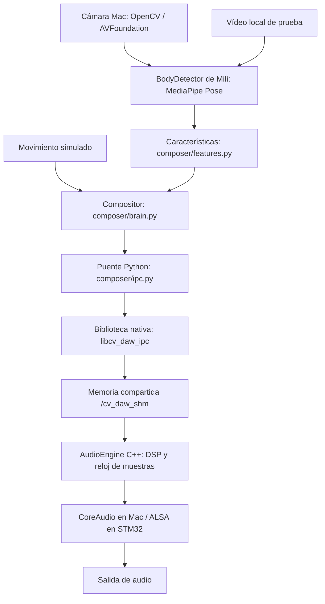

# Arquitectura integrada: Contemporary Ambient

## Qué hace el instrumento

La persona no selecciona cada nota. Su movimiento cambia las condiciones de una
composición: cuánta actividad tiene, qué tan abierta o tensa resulta, qué registro
usa y qué instrumentos aparecen. Las notas pertenecen a una misma escala y los
motivos regresan para que exista identidad musical.

`python -m composer.app --launch-engine` coordina ambos procesos. Python es el
controlador y C++ produce el audio. Al cerrar Python normalmente se detiene el
hijo C++ creado por él. También se puede ejecutar el motor por separado.

## Responsabilidades

| Componente | Responsabilidad |
| --- | --- |
| `BodyTrackingModule.py` | Detector de Mili, reutilizado sin modificarlo |
| `composer/app.py` | Cámara/vídeo/mock, ventana, ciclo de control y métricas |
| `composer/features.py` | Convierte pose en medidas interpretables |
| `composer/brain.py` | Elige armonía, motivos y ritmo con reglas deterministas |
| `composer/ipc.py` | Adjunta memoria y llama operaciones atómicas nativas |
| `realtime/ipc_bridge*` | Contrato binario y cola de mensajes |
| `realtime/audio_engine.hpp` | Ejecuta eventos en muestras concretas y mezcla |
| `realtime/dsp_primitives.hpp` | Síntesis, samples, envolventes, filtros y efectos |
| `realtime/audio_engine.cpp` | Dispositivo, inicio, modo offline y exportación WAV |
| `realtime/rt_startup.hpp` | Configuración específica de tiempo real Linux |

No se conecta el `src/brain.cpp` antiguo: usa otro ABI y otra memoria, `/cvdaw`.
No se ejecuta pygame dentro de la aplicación nueva. El prototipo original sigue
siendo una aplicación independiente.

## Características de movimiento

La pose se expresa respecto al centro de las caderas y se divide por la longitud
del torso. Se corrige la relación alto/ancho de la imagen. Esto reduce cambios
causados por distancia a la cámara, aunque no elimina errores de perspectiva.

Antes de derivar se suavizan las posiciones con una constante de 40 ms. Esto
reduce ruido y **añade retardo**. El tiempo entre imágenes se mide realmente;
no se supone que la cámara siempre entregue 30 o 60 FPS.

| Característica | Regla inicial |
| --- | --- |
| Velocidad | Cambio de muñecas/tobillos visibles, en longitudes de torso/s |
| Aceleración | Cambio de esas velocidades por segundo |
| Energía | Velocidad media normalizada y suavizada durante unos 300 ms |
| Fluidez | `1 / (1 + aceleración_media / 20)`; aproximación, no juicio artístico |
| Expansión | Distancia entre muñecas dividida por el torso y limitada a 0..1 |
| Quietud | `1 - energía` |
| Simetría | Diferencia entre posiciones reflejadas de izquierda y derecha |
| Periodicidad | Autocorrelación positiva de velocidad, remuestreada a 30 Hz |

Se exige ver hombros y caderas con confianza >0.5 y al menos una muñeca.
Las extremidades ocultas se excluyen de velocidad/aceleración. Si reaparecen,
no se interpreta el salto de detección como un golpe. La expansión mantiene el
último valor cuando no se ven ambas muñecas. Para interpretar piernas y simetría
completa, hay que alejarse hasta incluir los pies.

Perder la pose baja a cero las ganancias, deja de generar nuevas notas y conserva
el tiempo musical. La reverb puede dejar una cola breve. No existe todavía un
clasificador entrenado de estilos de danza ni seguimiento de varias personas.

## Tres tiempos musicales

### Rápido: cada imagen procesada

La energía controla ganancias por instrumento. La expansión abre el filtro y
cambia el balance melódico. La fluidez aumenta reverb; la abruptitud abre el filtro
del motivo. La asimetría aporta una desviación de afinación pequeña, hasta un cuarto
de semitono, y permite variaciones melódicas. Aceleraciones fuertes pueden producir
un acento de la tríada, con separación mínima de 300 ms.

C++ suaviza controles en cada muestra para evitar escalones audibles. La vía rápida
no espera a la siguiente frase, pero depende de captura, inferencia y suavizado.

### Medio: actualización aproximadamente cada segundo

Se promedian hasta 120 observaciones recientes (unos cuatro segundos a 30 FPS).
La energía aumenta densidad y tempo; la periodicidad también influye ligeramente
en el tempo. El rango inicial es aproximadamente 68..92 BPM. Poca energía elimina
percusión; energía media añade un kick tenue; energía alta añade hi-hat y más notas
del motivo. La fluidez modifica pequeños desplazamientos rítmicos alternados.

### Lento: frases de dos compases en 4/4

La escala es Do menor natural: Do, Re, Mi bemol, Fa, Sol, La bemol, Si bemol.
La ruta armónica inicial es **i → VI → iv → v**. Cada acorde pertenece a esa
escala. La quietud lleva a la tónica; energía alta y movimiento abrupto favorecen
el quinto grado para crear tensión. Los cambios ocurren al entrar en una frase,
no al saltar un píxel de la muñeca.

El motivo de ocho grados se repite y se transpone respecto al acorde. La expansión
puede subirlo una octava. Una semilla fija (7 por defecto) controla las pequeñas
variaciones: el mismo flujo de características y tiempo produce la misma partitura.
Esto es una primera gramática musical, no una garantía de calidad estética.

## Instrumentos iniciales

Se usan cuatro buses existentes: acorde senoidal, motivo de saw filtrado, kick y
hi-hat. Los sonidos se generan/cargan antes de reproducir. Hay ocho voces por bus,
con robo determinista de la más antigua cuando se llena. Las envolventes actuales
limitan las notas a unos dos segundos más release; el preset es ambiental con
pulsos y espacios, no un sintetizador de pads de duración ilimitada.

Los cuatro stems y Rubber Band siguen siendo opcionales. No son necesarios para
comprobar la composición y se desactivan en el primer build de Mac.

## Comunicación y tiempo

El ABI integrado es **versión 2**. Se añadió `limb_gain[4]` para controlar dinámica
sin simular miles de NOTE_ON. La biblioteca y el ejecutable se deben recompilar
juntos. Los comandos siguen midiendo 16 bytes y la cola sigue teniendo 256 entradas.

Python mapea `/cv_daw_shm`; ctypes llama C++ para publicar controles y hacer
`try_push` con acquire/release. No escribe directamente dentro de `std::atomic`.
Solo puede haber un controlador a la vez. El audio consume la cola y ordena eventos
por `target_frame`, conservando el orden de envío para tiempos iguales.

El compositor planifica aproximadamente 50 ms hacia delante para tolerar el
planificador de Python. Los eventos viven en el reloj absoluto de muestras, no
en segundos de pared. Los controles continuos se aplican al próximo bloque.
Si Python se atasca, se saltan ticks antiguos en vez de disparar una ráfaga atrasada.
Esta política prioriza continuidad musical en Mac y **no demuestra <35 ms**.

## Diferencias Mac / STM32

| macOS | OpenSTLinux STM32 |
| --- | --- |
| miniaudio `ma_backend_coreaudio`, salida predeterminada | miniaudio `ma_backend_alsa`, `hw:0,0` |
| Sin pedir SCHED_FIFO ni fijar CPU 1 | Afinidad, FIFO 90 y mlockall en inicialización Linux |
| Apple Silicon: FTZ y NEON disponibles | Cortex-A35: FTZ y NEON; opción específica de compilación |
| 48 kHz estéreo float en callback; CoreAudio puede adaptar dispositivo | Se verifica geometría nativa ALSA 128 frames / dos periodos |
| Validación funcional y mediciones estadísticas | Requiere medición de WCET, IRQ, prioridades, fallos de página y XRUNs |

Dentro de `processBlock()` no hay asignaciones, locks, archivos, consola ni llamadas
al sistema. Tampoco se introdujeron esas operaciones en nuestro callback. Cuando
se pide perfilado, se leen registros de contador ARM, sin usar `clock_gettime` ni
`mach_absolute_time` en el callback. Los resultados se publican con stores atómicos;
la impresión ocurre en el hilo principal, al terminar.

La escritura WAV se hace únicamente en el ciclo offline fuera de `processBlock`.
Nunca se escribe un archivo desde el callback CoreAudio. Las pruebas de Linux
conservan guards de allocators/mutex y seccomp. Que una prueba pase no constituye
una demostración matemática de ausencia de todas las rutas problemáticas.

## Cómo interpretar las mediciones

`processed_fps` mide imágenes/características procesadas, no los FPS nominales.
`max_python_processing_ms` incluye la espera/captura del ciclo y puede contener
el arranque frío de MediaPipe. La prueba de ida y vuelta IPC incluye espera del
siguiente bloque y sondeo Python: no mide solo el coste de escribir una cola.

La media/máximo del callback instrumentado mide DSP y wrapper, no toda la pila de
CoreAudio ni el tiempo hasta el altavoz. El contador XRUN actual detecta EPIPE en
Linux; **cero en Mac no certifica ausencia de dropouts CoreAudio**. Todavía falta
una medida física sincronizada de movimiento a salida analógica y una sesión
real de danza escuchada por la persona usuaria.
